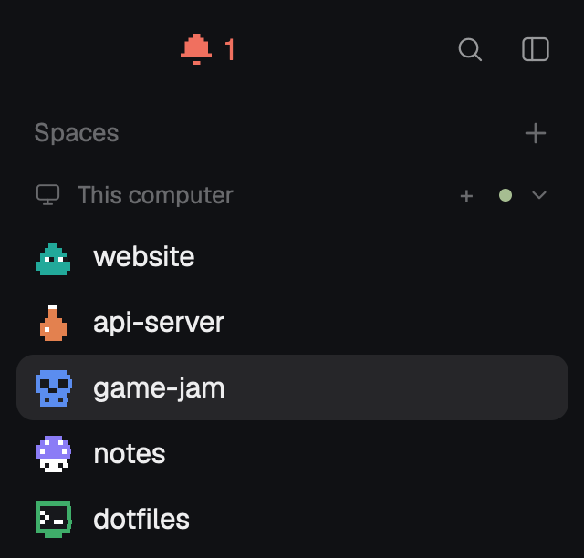
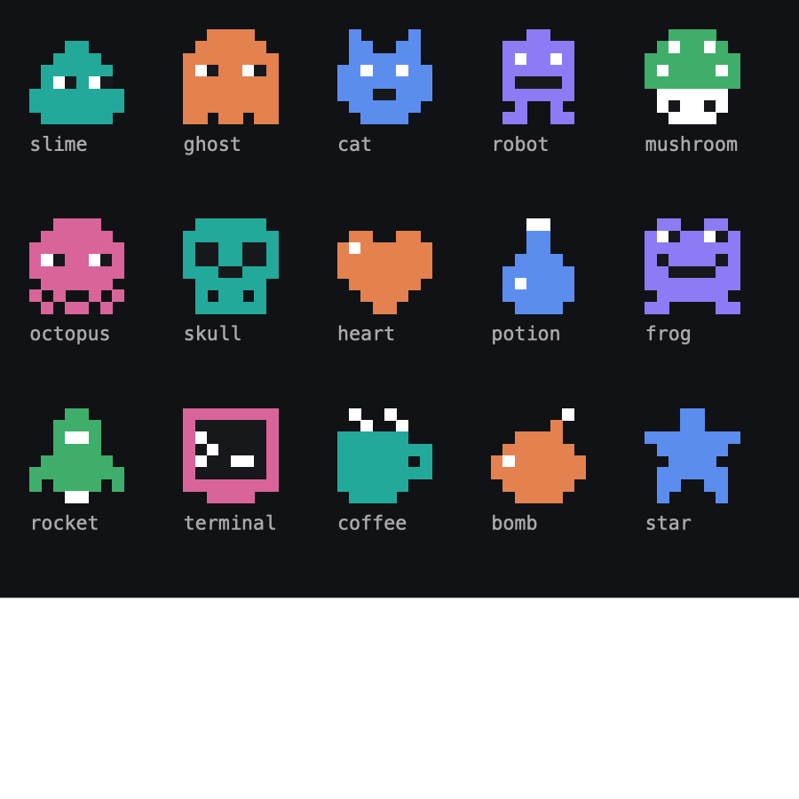

# Herdr Pixel Spaces

A pixel-art sidebar for the [Herdr](https://herdr.dev) desktop app. Each space wears a little 8×8
sprite in its color instead of a letter tile, the Go to picker shows the same sprites, and the
sidebar's header drops Herdr's logo for the one thing worth seeing up there: whether an agent is
waiting for you.



## What you get

- **Pixel sprites for spaces.** 15 sprites: slime, ghost, cat, robot, mushroom, octopus, skull,
  heart, potion, frog, rocket, terminal, coffee, bomb and star, all drawn for this repo. A new
  space gets the sprite used least so far and keeps it. **Option-click** (Alt-click) a sprite to
  step to the next one; a plain click still opens the space.
- **The same sprites in the Go to picker** (`cmd-p`, and the sidebar's search button), next to
  each space's name.
- **A header that only says who's waiting.** Where Herdr shows its logo and name, a pixel bell
  and a count appear when agents wait for you: blocked on a question or a permission, or done
  while you weren't looking. Blue when they're only done, the blocked color when any is blocked,
  nothing at all when none wait. Click it to go to the most urgent one (blocked first, then the
  most recently finished).
- **Still Herdr's sidebar.** These are Herdr's own `spaces`, `picker` and `workspace-chrome` mods
  with only those parts changed: space colors, worktrees under their repo, branch and
  ahead/behind, a group per machine, the right-click menu, drag to reorder, picker search and
  keys all work as before.



## Install

Ask your agent: "add https://github.com/pilmokim/herdr-pixel-spaces to my Herdr app". Or by hand:

```sh
git clone https://github.com/pilmokim/herdr-pixel-spaces.git
cd herdr-pixel-spaces
cp -R mods/pixel-spaces mods/pixel-picker mods/pixel-chrome ~/.config/herdr-app/mods/
cp layouts/main-pixel.json ~/.config/herdr-app/layouts/
herdr-app do layout.switch '{"name":"main-pixel"}'
```

`main-pixel` is Herdr's own `main` layout (0.1.11) with the header and the spaces list swapped
for these mods. `cmd-shift-l` switches back to any other layout.

Then point `cmd-p` at the pixel picker in `~/.config/herdr-app/keys.json` (this repo's
`keys.json` has the line to merge):

```json
{ "global": { "cmd-p": "mod.open:pixel-picker" } }
```

Option-click needs Option to reach Herdr as Alt. That's automatic on US and ABC keyboard layouts;
on others (Korean 2-Set, for one) add `"option_as_alt": "on"` to
`~/.config/herdr-app/settings.json`.

### Your own layout

In a layout of your own, point its blocks at these mods:

```json
{ "id": "brand", "type": "block", "size": { "px": 46 }, "content": { "mod": "pixel-chrome" } },
{ "id": "spaces", "type": "block", "size": { "weight": 1 }, "min": 90, "content": { "mod": "pixel-spaces" } }
```

## Draw your own sprite

Sprites live in `mods/pixel-spaces/sprites.js`, each one 8 strings of 8 characters:

```js
ghost: [
  "..xxxx..",
  ".xxxxxx.",
  "xxxxxxxx",
  "xokxxokx",
  "xxxxxxxx",
  "xxxxxxxx",
  "xxxxxxxx",
  "xx.xx.xx",
],
```

`x` is the space's color, `o` white, `k` near-black, `.` clear. Add an entry and save: Herdr
reloads the mod at once and the new sprite joins the rotation. `mods/pixel-picker/sprites.js` is
a copy of the same file (a Herdr mod can't import from another mod's folder): change both.

## How it's kept

Each space's sprite is stored by space id in Herdr's shared mod state (`space.sprites`), next to
the colors Herdr already keeps there (`space.colors`). A color there can be a `#rrggbb` as well
as one of Herdr's six. Unlike the shipped mods, these leave both alone when they see no spaces
at all, so a `herdr-app check` run doesn't wipe everyone's colors.

## License

Apache-2.0. The three mods' `main.js` files are Herdr's `spaces`, `picker` and
`workspace-chrome` mods (Apache-2.0) with the changes their headers describe. The `search`,
`sidebar`, `settings` and `plus` glyphs in `mods/pixel-chrome/` are Lucide's (ISC, see
`mods/pixel-chrome/LICENSE-Lucide.txt`). `sprites.js`, the sprites and the bell are new.
