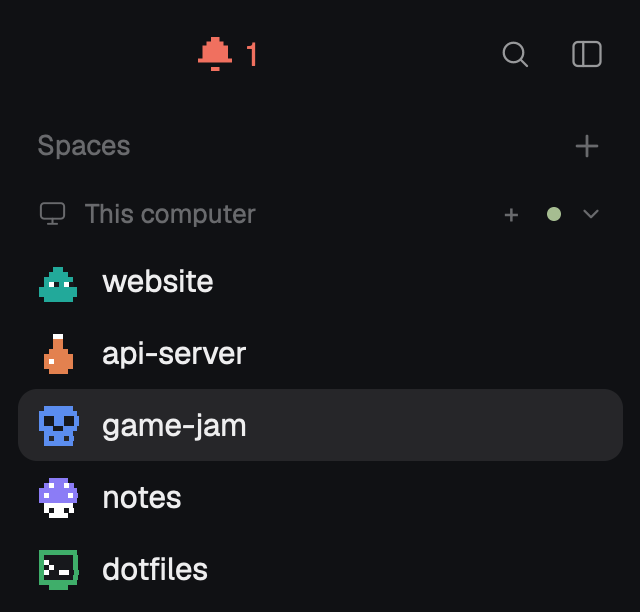

# Pixel Spaces

Herdr's spaces list with pixel-art avatars. Each space wears a small 8×8 sprite, a slime, a ghost,
a frog, drawn in the space's own color where Herdr shows a tile with the first letter. Everything
else about the list is Herdr's.

## What you see

- The spaces sidebar exactly as in Herdr's `main` layout: a "Spaces" header with a `+`, a group
  header per machine, one row per space (30px, 28px for worktree rows), the space's name, then its
  repo, branch and ahead/behind where unusual.
- In place of the 18px rounded tile with a white capital letter: an 18px box holding a 16×16
  sprite, 8×8 sprite pixels at 2px each, no tile behind it.
- Sprite colors: `x` pixels in the space's avatar color (Herdr's `MARK` table: `ansi6` #22a99a,
  `ansi3` #e3814f, `ansi4` #5b8def, `ansi5` #8b7cf6, `ansi2` #3fae6a, `ansi1` #d9649a), `o` pixels
  #ffffff, `k` pixels #17181c, `.` clear.
- 15 sprites: slime, ghost, cat, robot, mushroom, octopus, skull, heart, potion, frog, rocket,
  terminal (a `>_` prompt), coffee, bomb, star. All original drawings.
- Worktree rows keep Herdr's branch icon and no sprite; the narrow rail keeps Herdr's number and
  status glyph.
- The Go to picker (`cmd-p`) shows the same sprite, same color, in each space's heading row in
  place of the 18px letter tile.

## How it behaves

- A space without a sprite gets the one used least among the shown spaces; ties are broken by a
  hash of the space's name, so two new spaces rarely start alike. Once given, a sprite stays.
- Option-click (Alt) on a sprite steps that space to the next sprite in the list, wrapping
  around, and the click does not select the space. Any other click, right-click and drag behave
  as in Herdr's list.
- Sprites of spaces that are gone are dropped, as Herdr drops their colors.
- When the mod sees no spaces at all (as under `herdr-app check`), it changes neither colors nor
  sprites.

## Built from

- Layout `layouts/main-pixel.json`: Herdr's `main` (0.1.11), cloned with `layout.clone`, with the
  block `id: "spaces"` set to `content.mod: "pixel-spaces"`.
- Mod `mods/pixel-spaces/`: Herdr's `spaces` mod cloned with `mod.clone`. Changes in `main.js`:
  the avatar `h_flex` in `row()` holds `sprite(name, fill, ...)` with an `on_mouse_down("left")`
  that, when `e.modifiers.alt`, calls `cx.stop_propagation()` and writes the next name to shared
  `space.sprites`; `render()` assigns sprites with `assign()` after the colors, and wraps both the
  color and the sprite bookkeeping in `if (spaces().length)`.
- `sprites.js`: `SPRITES` (name to 8 strings of 8 chars), `NAMES`, `sprite()` (each row's runs of
  one character become one `div` of width `2 * run`, height 2), `assign()`.
- Mod `mods/pixel-picker/`: Herdr's `picker` cloned with `mod.clone`. The heading row's avatar
  holds `sprite(shared("space.sprites")[id], spaceColor(t, w), ...)`; `spaceColors()` returns the
  stored colors untouched when `spaces()` is empty. It only reads `space.sprites`. Its own copy of
  `sprites.js`. `keys.json`: `"cmd-p": "mod.open:pixel-picker"` in `global`.
- `herdr` functions: `spaces`, `shared`, `setShared`, `theme`, plus everything Herdr's mod uses.
  No programs, no network, no files outside the mod.

## Watch out

- `herdr-app check` runs the mod with no spaces against the real shared state. Herdr's own
  bookkeeping drops every entry whose space isn't listed, so a check run would wipe
  `space.colors` and `space.sprites`. Keep the `if (spaces().length)` guard.
- Option is Alt only where Herdr sends it as Alt (`option_as_alt`, "auto" on US/ABC layouts). On
  other keyboard layouts, set `"option_as_alt": "on"` in settings.json for option-click.
- Herdr doesn't watch a symlinked mod folder; copy it rather than link it.
- A mod can't import from another mod's folder (`../pixel-spaces/sprites.js` is refused as
  outside the mod), so each mod carries `sprites.js`; keep the copies identical.
- The sidebar's search button (shipped `workspace-chrome`) opens the shipped `picker`, not this
  one.
- Sprites must be exactly 8×8 and use only `.`, `x`, `o`, `k`.

## Done when

- Every non-worktree space row shows a sprite in its color and no letter tile.
- A new space gets a sprite not yet used by the shown spaces (while fewer than 15 spaces show).
- Option-click on a sprite changes it to the next one and leaves the selected space as it was.
- `herdr-app check mods/pixel-spaces` and `herdr-app check mods/pixel-picker` pass and leave
  `space.colors` and `space.sprites` in `shared.json` unchanged.
- `cmd-p` opens the picker with each space's sprite beside its name, matching the sidebar.
